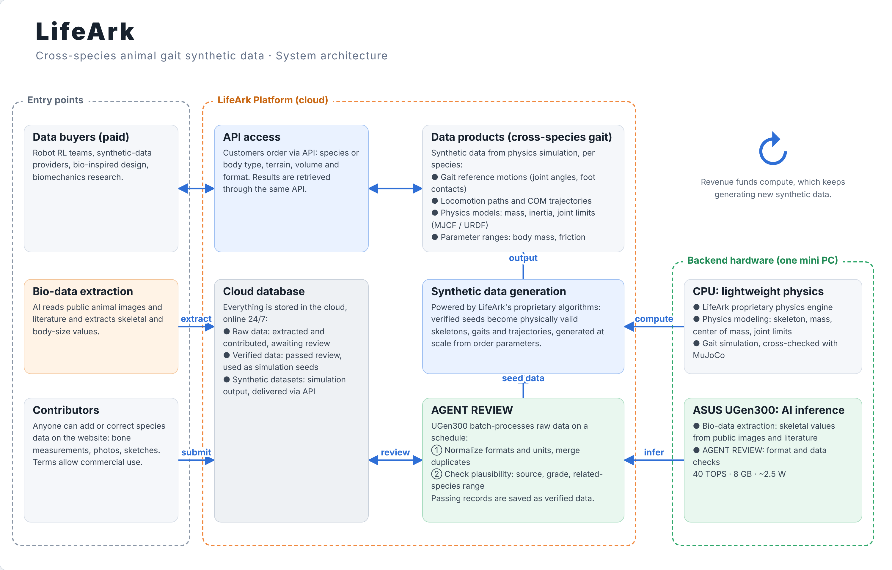

# LifeArk

**Cross-species animal gait synthetic data for robot training.**

ASUS UGen AI League 2026 · Workplace AI · Battlefield Lightning (ASUS UGen300)

This repository is LifeArk's public proposal: the system architecture, the interfaces between its parts and the data formats.
The generation engine and the species data are proprietary and are **not** included.

## The problem

The best legged robots already learn to walk by imitating animal motion capture, but the data stops at a few dog clips.
Today's synthetic data and digital twins for legged robots reuse the same dog references, animal capture is lab-bound and covers few
species, and every new skill needs new reference motion. Nature has already solved slopes, loads, speed and balance in many
different bodies; none of that reaches robot training today.

## What LifeArk does

LifeArk turns nature's walking solutions into training data, in four steps:

| step | what happens | where it runs |
|---|---|---|
| 1. Extract | AI reads public animal images and literature and keeps only skeletal and body-size values. Contributors can also submit data. | ASUS UGen300 |
| 2. Review | AGENT REVIEW normalizes formats and units and checks plausibility. Passing records become verified seeds. | ASUS UGen300 |
| 3. Generate | Our proprietary algorithms turn seeds into gaits and trajectories for each species, from the order's parameters. | Mini PC CPU |
| 4. Deliver | Customers order by species or body type and download datasets through the API, in robotics-ready formats. | Cloud |

## Architecture

- **Entry points:** data buyers (paid, through the API), bio-data extraction, and contributors (through the website).
- **Cloud platform:** website and API, the cloud database (raw data, verified data, synthetic datasets), AGENT REVIEW, synthetic
  data generation and data products. It stays online 24/7.
- **Backend:** one mini PC. The ASUS UGen300 runs all AI inference; the CPU runs our physics engine. The node only makes
  outbound connections: it pulls jobs from the cloud and pushes results back, so no ports are opened.

Contracts between the parts: [`docs/interfaces.md`](docs/interfaces.md).

## Software

| part | contents |
|---|---|
| Cloud platform | Website and API (orders, downloads, contributions); cloud database for raw data, verified data and synthetic datasets; Cloudflare (D1, R2) |
| Proprietary algorithms | Skeleton and physics model (mass, inertia, center of mass, joint limits); gait generation per order parameters; cross-checked with MuJoCo; closed source |
| AI models on UGen300 | Qwen2-VL-2B-Instruct reads animal images and sketches; Qwen2-1.5B-Instruct runs AGENT REVIEW (format and plausibility checks) |

## Hardware

| device | role | specification |
|---|---|---|
| ASUS UGen300 (USB) | AI inference: extraction and AGENT REVIEW | Hailo-10H, 40 TOPS INT4 / 20 TOPS INT8, 8 GB LPDDR4, about 2.5 W, USB 3.1 Gen 2. Qwen2-VL-2B 6.73 tokens/s, Qwen2-1.5B 6.23 tokens/s (ASUS datasheet) |
| Mini PC CPU | Physics: our engine, batch gait generation per order | Outbound connection only |

Why the edge: owned hardware replaces per-token cloud AI fees with a fixed cost, the low-power node runs around the clock, and
extraction and review need no third-party AI service.

## Data products

Per species or body type:

| product | contents |
|---|---|
| Gait reference motions | joint angles and foot-contact timing |
| Locomotion trajectories | paths and center-of-mass trajectories |
| Physics model files | mass, inertia, joint limits (MJCF / URDF) |
| Parameter ranges | body mass and friction ranges for randomized training |

Order and delivery formats: [`schemas/order.schema.json`](schemas/order.schema.json) and
[`schemas/dataset-manifest.schema.json`](schemas/dataset-manifest.schema.json).

## Data sourcing

**Extract, don't store.** AI reads public images and literature and keeps only skeletal measurements; source media is discarded
after processing. Public data is taken only under CC0 or CC BY, with non-commercial records excluded, and contributors agree to
terms that allow commercial use. Every value keeps its source and grade: see
[`schemas/species-skeleton.schema.json`](schemas/species-skeleton.schema.json) (field definitions only).

## What is in this repository

| path | what |
|---|---|
| `docs/architecture.png` | system architecture |
| `docs/interfaces.md` | API, node and record contracts |
| `schemas/order.schema.json` | what a customer sends to order a dataset |
| `schemas/dataset-manifest.schema.json` | what a delivered dataset describes |
| `schemas/species-skeleton.schema.json` | the seed record format: one species, every number with its source |

Not included: the generation engine, the species data and the trained review prompts.

## License

MIT for the documents and schemas in this repository (see `LICENSE`). Third-party components: `THIRD_PARTY_NOTICES.md`.
The LifeArk name is not covered by the license: `TRADEMARKS.md`.
